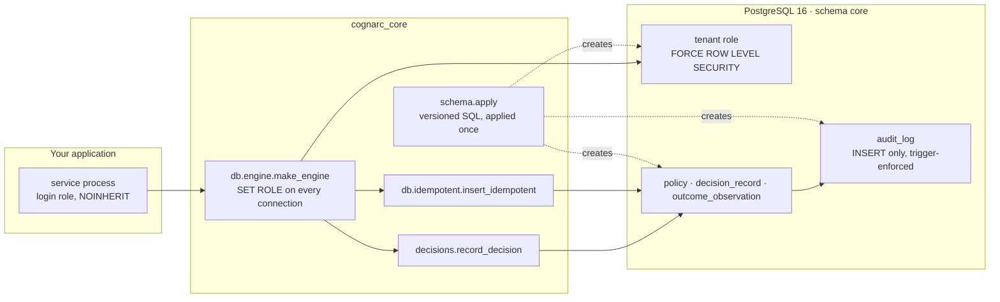

<div align="center" id="readme-top">

<a href="https://cognarc.ai"></a>

### Decision records you can audit.

<p align="center">
  <a href="https://github.com/Cognarc-Inc/cognarc-core/actions/workflows/ci.yml"></a>
  <a href="https://github.com/Cognarc-Inc/cognarc-core/tags"></a>
  <a href="LICENSE"></a>
  <a href="pyproject.toml"></a>
  <a href="docs/SCHEMA.md"></a>
  <a href="pyproject.toml"></a>
</p>

[Website](https://cognarc.ai) · [Contract](docs/CONTRACT.md) · [Schema](docs/SCHEMA.md) · [Changelog](CHANGELOG.md) · [繁體中文](README.zh-TW.md)

</div>

<br>

# What is Cognarc Core

```text
$ uv run python examples/quickstart.py
applied: ['000_bootstrap.sql', '010_tenancy.sql', '020_ledger.sql', '030_audit_log.sql']
re-apply: []                                   # idempotent: nothing left to apply
decision_id: c77fd883-8978-4be5-bdaa-9238e62c0012
acme sees: 1                                   # the tenant that wrote it
audit rows: [('decision_recorded', 'decision:c77fd883-8978-4be5-bdaa-9238e62c0012')]
globex sees: 0                                 # another tenant, same table, same database
owner UPDATE rejected: core.audit_log 只允許 INSERT（拒絕 UPDATE）   # "INSERT only (UPDATE rejected)", even for the schema owner
tenant UPDATE rejected: permission denied for table audit_log
```

<p align="center"><em>Real output of <a href="examples/quickstart.py"><code>examples/quickstart.py</code></a> against PostgreSQL 16 on 2026-10-29. Ids differ on every run.</em></p>

Cognarc Core is **a contract plus PostgreSQL primitives that make *who decided what, when, under
which policy, and what happened next* traceable and tamper-resistant by construction, not by
convention.** It helps engineering teams in regulated or high-stakes domains keep an audit-grade
record of every decision without re-implementing tenant isolation, idempotent writes and
append-only storage in every service.

It is domain-neutral: nothing in the package knows about trading, releases, lending or any other
business. It is a library, not a service. You bring PostgreSQL 16+ and SQLAlchemy 2; Cognarc Core
brings the schema, the role model and a handful of functions that respect them. Cognarc Inc.
maintains it and runs it in production under its own products.

## News

- **2026-10-29**: `v0.1.0`, the first public release. It contains the decision-record contract, the
  PostgreSQL ledger primitives and schema `000`–`030`. See the
  [changelog](CHANGELOG.md#010---2026-10-29).

## Who this is for

- Teams whose decisions must be defensible afterwards: trading and treasury operations, release
  and change management, credit decisions, clinical or safety workflows.
- Platform engineers who need multi-tenant PostgreSQL where isolation is enforced by the
  database, not by remembering a `WHERE tenant_id = ?`.
- Anyone who has been asked "who approved this, based on what, and when did we know?" and could
  not answer from the data.

## Guarantees

| Guarantee | How it is enforced |
| --- | --- |
| A row belongs to exactly one tenant and only that tenant can read or write it | Every tenant table has `FORCE ROW LEVEL SECURITY` with `tenant_id = core.current_tenant_id()`; the tenant is derived from the connection's `SET ROLE`, and a role bound to no tenant sees nothing |
| Decisions and audit rows are never changed or deleted | Roles receive `SELECT` and `INSERT` only, and triggers reject `UPDATE`, `DELETE` and `TRUNCATE` even for the owner and superusers; corrections are new rows |
| Writing the same thing twice yields one row | `insert_idempotent` uses the table's unique key and returns the existing row on conflict |
| Time is unambiguous | All timestamps are timezone-aware UTC; four columns stay separate: `event_time`, `published_at`, `available_at`, `ingested_at` |
| People are referenced, not named | `actor`, `created_by`, `approved_by` hold principal ids; names never enter the ledger |
| The schema has one source | Versioned SQL files applied in order and recorded in `core.schema_applied`; Python reflects tables instead of redefining them |
| "We decided not to act" leaves the same trail as acting | A hold, a rejection or a no-trade is a `DecisionRecord` like any other; the contract has no silent path |

Cognarc Core records decisions made by accountable people and systems. It contains no scoring,
recommendation or automatic approval logic, by design.

## Quick start

### Set it up with your coding agent

Copy this prompt into any agent that can read a web page and run shell commands, such as Claude
Code or Codex:

```text
Read https://github.com/Cognarc-Inc/cognarc-core#quick-start and add cognarc-core to this project. Follow the four Quick start steps against a throwaway PostgreSQL 16 database, never a production one, and show me the output of each step.
```

### 1. Install

Install from the tagged Git release; PyPI publication will be announced in
[CHANGELOG.md](CHANGELOG.md):

```bash
uv add "cognarc-core @ git+https://github.com/Cognarc-Inc/cognarc-core@v0.1.0"
# or
pip install "git+https://github.com/Cognarc-Inc/cognarc-core@v0.1.0"
```

Requirements: Python 3.12 or 3.13, PostgreSQL 16 or newer (the role model uses
`GRANT ... WITH INHERIT/SET`, introduced in 16).

### 2. Apply the schema

Run once with a connection that can create roles and schemas (your migration identity):

```python
from sqlalchemy import create_engine
from cognarc_core import schema

admin = create_engine("postgresql+psycopg://postgres@127.0.0.1:5432/myapp")
schema.apply(admin, owner_role="myapp_owner", line_role="myapp_line", line="main")
```

`apply()` creates `myapp_owner` (owns the `core` schema) and `myapp_line` (the permission set for
one application line), then applies every SQL file not yet recorded in `core.schema_applied`.
Running it again is safe and returns `[]`. A *line* is a group of tenants that share one policy
and role model; use `"main"` if you have only one.

### 3. Provision a tenant

One database role per tenant per line, bound to the tenant in `core.tenant_role`, and one login
role for your service that may `SET ROLE` into it:

```sql
CREATE ROLE myapp_t_acme_main NOLOGIN INHERIT;
GRANT myapp_line TO myapp_t_acme_main WITH INHERIT TRUE, SET FALSE;
INSERT INTO core.tenant (tenant_id, slug) VALUES ('<tenant uuid>', 'acme');
INSERT INTO core.tenant_role (role_name, tenant_id, line) VALUES ('myapp_t_acme_main', '<tenant uuid>', 'main');

CREATE ROLE myapp_svc LOGIN NOINHERIT;              -- no data privileges until it SET ROLEs
GRANT CONNECT ON DATABASE myapp TO myapp_svc;
GRANT myapp_t_acme_main TO myapp_svc WITH INHERIT FALSE, SET TRUE;
```

### 4. Record a decision

```python
import uuid
from datetime import UTC, datetime

from cognarc_core.db.engine import make_engine
from cognarc_core.decisions import record_decision

# Every new connection runs SET ROLE myapp_t_acme_main, so row-level security applies.
engine = make_engine("postgresql+psycopg://myapp_svc@127.0.0.1:5432/myapp", set_role="myapp_t_acme_main")

with engine.begin() as conn:
    decision_id = record_decision(
        conn,
        workspace_id=uuid.UUID("3f1a4f0e-9f2c-4f3b-9e2d-0c8a5f2d7b11"),
        subject_ref="release:2026.10.29",
        actor=uuid.UUID("9b7a2d1c-5e4f-4a6b-8c9d-1e2f3a4b5c6d"),  # a principal id, never a name
        role="release_manager",
        decision="release",
        at=datetime.now(UTC),
        policy_version="release-policy/v3",
        inputs_refs=["ci:run/8812", "pr:412"],
    )
```

The insert also writes a `decision_recorded` row to `core.audit_log` through a trigger. Any later
`UPDATE` or `DELETE` on either table fails, for every role.

[`examples/quickstart.py`](examples/quickstart.py) runs these four steps end to end and produced
the output at the top of this page; `tests/integration/test_tenancy_and_ledger.py` covers the same
path under test.

## Architecture



<p align="center"><em>The guarantees live in PostgreSQL; the Python layer only connects, writes and applies the schema.</em></p>

Your service logs in with a role that has no data privileges, and every connection immediately
`SET ROLE`s into one tenant's role. From there on PostgreSQL does the work: row-level security
filters every read and write to that tenant, grants allow only `SELECT` and `INSERT`, and
triggers refuse changes to anything already written. The Python layer is thin on purpose; the
guarantees do not depend on it.

## The contract

Every feature that produces a decision, an authorization, an action or an outcome has to say
where it sits on one chain and which object it writes:

```text
evidence → proposal → assessment → policy → authorization → decision → action → outcome → calibration
```

| Link | Shared object | Shipped as DDL in this distribution |
| --- | --- | --- |
| Policy | `Policy` (versioned) | `core.policy` |
| Decision | `DecisionRecord` | `core.decision_record` |
| Outcome | `OutcomeObservation` | `core.outcome_observation` |
| Evidence, Proposal, Assessment, Authorization, Action, Calibration | semantics only | Fields differ too much between domains; your product defines the tables, the contract defines the required columns |

Every object carries the same spine: `tenant_id`, `workspace_id`, the four time columns,
`valid_from`/`valid_to`, versions (`source_version`, `policy_version`, …), `lineage` and
`confidentiality`. The full text is in [`docs/CONTRACT.md`](docs/CONTRACT.md) and the
machine-readable form in
[`contracts/decision_record.schema.json`](contracts/decision_record.schema.json).

## Core modules

| Module | What it adds |
| --- | --- |
| `cognarc_core.schema` | `load()`, `render()` and `apply()` for the versioned SQL files; `sql_dir()` |
| `cognarc_core.db.engine` | `make_engine(url, set_role=...)` issues `SET ROLE` on every new connection; `validate_role_name()` |
| `cognarc_core.db.idempotent` | `insert_idempotent(conn, table, values, conflict_cols, index_where=...)` returns `(row, created)` |
| `cognarc_core.db.reflect` | `reflect_table(conn, "core.decision_record")`, so Python never redefines the schema |
| `cognarc_core.decisions` | `record_decision(conn, ...)`, the minimal implementation of the contract |
| `cognarc_core.clock` | `SystemClock` and `ManualClock` (injectable in tests); always timezone-aware UTC |
| `cognarc_core.tier()` | Reports which distribution is installed (`"oss"` here) |

| SQL file | Creates |
| --- | --- |
| `000_bootstrap.sql` | Owner and line roles, the `core` schema, `core.schema_applied` |
| `010_tenancy.sql` | `core.tenant`, `core.tenant_role`, `core.current_tenant_id()` |
| `020_ledger.sql` | `core.policy`, `core.decision_record`, `core.outcome_observation` with forced row-level security |
| `030_audit_log.sql` | Append-only `core.audit_log`, the INSERT-only triggers, automatic audit of decision records |

<br>
<div align="right">

[](#readme-top)

</div>

## Upgrading

Released SQL files are never rewritten. A new version adds files with higher numbers; running
`schema.apply()` again applies only those and records them. Upgrade the package, run `apply()`
with the same arguments, done. Breaking changes before 1.0 are listed per version in
[CHANGELOG.md](CHANGELOG.md).

## Removing

Cognarc Core owns the `core` schema and the roles you named in `apply()`. Removing it deletes the
ledger, so export what you must keep first:

```sql
DROP SCHEMA core CASCADE;
DROP ROLE myapp_t_acme_main; DROP ROLE myapp_svc;   -- every tenant and service role you created
DROP ROLE myapp_line; DROP ROLE myapp_owner;
```

Then `pip uninstall cognarc-core`.

## Development

```bash
git clone https://github.com/Cognarc-Inc/cognarc-core.git && cd cognarc-core
uv sync
uv run pre-commit install      # ruff check + format on every commit
make lint                      # ruff check, ruff format --check, pyright strict
make test                      # unit tests, no database
make pg-up && make test-db     # integration tests on a throwaway PostgreSQL 16 (local binaries or Docker)
make pg-down
```

CI runs lint, unit tests on Python 3.12 and 3.13, a package build check and the integration tests
on every push and pull request; see [`.github/workflows/ci.yml`](.github/workflows/ci.yml).

## Documentation

- [`docs/CONTRACT.md`](docs/CONTRACT.md): the decision-record contract.
- [`docs/SCHEMA.md`](docs/SCHEMA.md): schema, role model, tenant provisioning, upgrade rules.
- [`CHANGELOG.md`](CHANGELOG.md): what changed in each version.

The two documents under `docs/` and the code docstrings are currently written in Traditional
Chinese; this README, the contributing guide and the security policy are in English, and
[`README.zh-TW.md`](README.zh-TW.md) is a Traditional Chinese translation of this page. English
translations of the documents are a welcome contribution (see [CONTRIBUTING.md](CONTRIBUTING.md)).
Identifiers such as `SPEC-01 §4` or `I-17` in docstrings refer to Cognarc's internal
specifications and are kept for traceability.

## Editions

| | `cognarc-core` (this repository) | `cognarc-core-enterprise` |
| --- | --- | --- |
| License | Apache-2.0 | Commercial, from Cognarc Inc. |
| Contract, clock, engine, idempotency, reflection, decisions, schema 000–030 | Yes | Yes |
| Identity governance: principals, two-person role grants, delegation limits, segregation of duties, access log | | Yes |
| Tamper-evident audit hash chain with daily seals exported to customer-controlled storage | | Yes |

Both editions install as the same package `cognarc_core`; install exactly one per environment and
check with `cognarc_core.tier()`. To ask about the enterprise edition, open an issue or visit
[cognarc.ai](https://cognarc.ai).

<br>
<div align="right">

[](#readme-top)

</div>

## Contributing

Issues and pull requests are welcome; please read [CONTRIBUTING.md](CONTRIBUTING.md) first. It
explains how this repository is produced from Cognarc's source repository at each release and how
your change gets in. Participation is governed by the [Code of Conduct](CODE_OF_CONDUCT.md).

## Security

Please report vulnerabilities privately as described in [SECURITY.md](SECURITY.md), not in a
public issue.

## Citation

If you use Cognarc Core in research or in a system you describe publicly, please cite it. GitHub's
*Cite this repository* button reads the same metadata from [`CITATION.cff`](CITATION.cff).

```bibtex
@software{cognarc_core,
  title   = {{Cognarc Core: a decision-record contract and PostgreSQL ledger primitives}},
  author  = {{Cognarc Inc.}},
  year    = {2026},
  url     = {https://github.com/Cognarc-Inc/cognarc-core},
  license = {Apache-2.0}
}
```

## License

[Apache License 2.0](LICENSE). Copyright © 2026 Cognarc Inc.

The Cognarc name, symbol and wordmark are trademarks of Cognarc Inc. and are not covered by the
Apache-2.0 license; see [`docs/assets/README.md`](docs/assets/README.md).

---

<p align="center"><a href="https://cognarc.ai"></a><br><sub><b>Cognarc</b> · Connect cognition with action.</sub></p>
