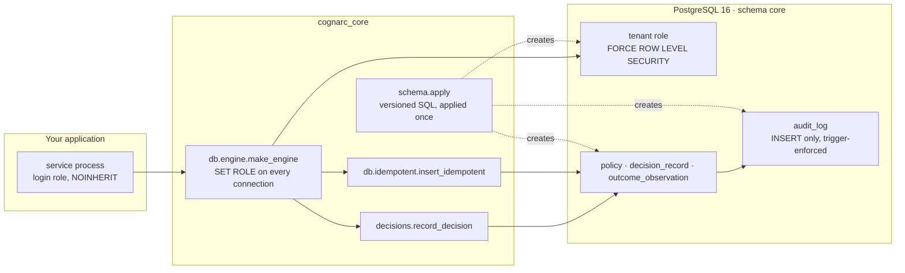

<div align="center" id="readme-top">

<a href="https://cognarc.ai"></a>

### 可以稽核的決策紀錄。

<p align="center">
  <a href="https://github.com/Cognarc-Inc/cognarc-core/actions/workflows/ci.yml"></a>
  <a href="https://github.com/Cognarc-Inc/cognarc-core/tags"></a>
  <a href="LICENSE"></a>
  <a href="pyproject.toml"></a>
  <a href="docs/SCHEMA.md"></a>
  <a href="pyproject.toml"></a>
</p>

[官網](https://cognarc.ai) · [架構](docs/ARCHITECTURE.md) · [契約](docs/CONTRACT.md) · [Schema](docs/SCHEMA.md) · [變更紀錄](CHANGELOG.md) · [English](README.md)

</div>

> 本文是 [README.md](README.md) 的繁體中文翻譯；兩者不一致時以英文版為準。

<br>

# Cognarc Core 是什麼

```text
$ uv run python examples/quickstart.py
applied: ['000_bootstrap.sql', '010_tenancy.sql', '020_ledger.sql', '030_audit_log.sql']
re-apply: []                                   # 冪等：沒有剩下要套用的檔案
decision_id: 658d3000-78e8-47f8-b272-34f1868877bc
acme sees: 1                                   # 寫入它的那個租戶
audit rows: [('decision_recorded', 'decision:658d3000-78e8-47f8-b272-34f1868877bc')]
globex sees: 0                                 # 另一個租戶：同一張表、同一個資料庫
admin UPDATE rejected: core.audit_log 只允許 INSERT（拒絕 UPDATE）   # superuser 會略過 row-level security，trigger 仍然拒絕
tenant UPDATE rejected: permission denied for table audit_log
```

<p align="center"><em><a href="examples/quickstart.py"><code>examples/quickstart.py</code></a> 於 2026-10-29 對 PostgreSQL 16 的實際輸出；每次執行的 id 都不同。</em></p>

Cognarc Core 是**一份契約加上一組 PostgreSQL 原語，讓「誰、在什麼時候、依哪一版政策、做了什麼
決定，之後發生了什麼」可以追溯而且難以竄改；這是由結構保證的，不靠團隊慣例。**它讓身處受監管或
高風險領域的工程團隊，不必在每個服務重做租戶隔離、冪等寫入與只增儲存，就能為每一個決策留下可供
稽核的紀錄。

它不綁任何領域：套件裡沒有任何關於交易、發布、授信或其他業務的知識。它是函式庫，不是服務。你提供
PostgreSQL 16+ 與 SQLAlchemy 2，Cognarc Core 提供 schema、角色模型，以及幾個遵守它們的函式。
Cognarc Inc. 負責維護，並在自家產品的正式環境中使用。

## 最新消息

- **2026-10-29**：`v0.1.0`，第一個公開版本。包含決策紀錄契約、PostgreSQL 帳本原語與 schema
  `000`–`030`。詳見[變更紀錄](CHANGELOG.md#010---2026-10-29)。

## 適合誰

- 決策事後必須站得住腳的團隊：交易與資金作業、發布與變更管理、授信決策、臨床或安全流程。
- 需要多租戶 PostgreSQL、而且希望隔離由資料庫執行，而不是靠每次記得寫 `WHERE tenant_id = ?` 的平台工程師。
- 被問過「這是誰核准的、依據什麼、我們什麼時候知道的？」卻無法從資料回答的人。

## 保證

| 保證 | 如何執行 |
| --- | --- |
| 每一列只屬於一個租戶，而且只有該租戶能讀寫 | 每張租戶資料表都 `FORCE ROW LEVEL SECURITY`，條件為 `tenant_id = core.current_tenant_id()`；租戶由連線的 `SET ROLE` 推得，沒有綁定租戶的角色什麼都看不到 |
| 決策與審計紀錄永不修改或刪除 | 角色只拿到 `SELECT` 與 `INSERT`，trigger 拒絕 `UPDATE`、`DELETE`、`TRUNCATE`，對 superuser 也一樣；更正另留一筆。持有 owner 角色或 superuser 的人可以先停用 trigger：見[信任邊界](docs/ARCHITECTURE.md#trust-boundaries) |
| 同一件事寫兩次只會有一列 | `insert_idempotent` 以資料表的 unique 鍵判定，衝突時回傳既有那一列 |
| 時間沒有歧義 | 所有時間戳記都是帶時區的 UTC；四個欄位分開：`event_time`、`published_at`、`available_at`、`ingested_at` |
| 人以代碼參照，不存姓名 | `actor`、`created_by`、`approved_by` 存 principal id；姓名永遠不進帳本 |
| schema 只有一個來源 | 版本化的 SQL 檔依序套用並記錄在 `core.schema_applied`；Python 以反射取得資料表，不重複定義 |
| 「決定不做」和「做了」留下同樣的軌跡 | 暫緩、拒絕或不交易都是一筆 `DecisionRecord`；契約裡沒有無聲的路徑 |

Cognarc Core 記錄的是由負責任的人與系統所做的決策。它刻意不包含任何評分、建議或自動核准的邏輯。

## 快速開始

### 交給你的 coding agent 安裝

把下面這段提示貼給任何能讀網頁、能執行 shell 指令的 agent，例如 Claude Code 或 Codex：

```text
Read https://github.com/Cognarc-Inc/cognarc-core#quick-start and add cognarc-core to this project. Follow the four Quick start steps against a throwaway PostgreSQL 16 database, never a production one, and show me the output of each step.
```

### 1. 安裝

從已打 tag 的 Git 版本安裝；上架 PyPI 時會在 [CHANGELOG.md](CHANGELOG.md) 公告：

```bash
uv add "cognarc-core @ git+https://github.com/Cognarc-Inc/cognarc-core@v0.1.0"
# 或
pip install "git+https://github.com/Cognarc-Inc/cognarc-core@v0.1.0"
```

需求：Python 3.12 或 3.13、PostgreSQL 16 以上（角色模型用到 16 才有的 `GRANT ... WITH INHERIT/SET`）。

### 2. 套用 schema

以能建立角色與 schema 的連線（你的 migration 身分）執行一次：

```python
from sqlalchemy import create_engine
from cognarc_core import schema

admin = create_engine("postgresql+psycopg://postgres@127.0.0.1:5432/myapp")
schema.apply(admin, owner_role="myapp_owner", line_role="myapp_line", line="main")
```

`apply()` 會建立 `myapp_owner`（擁有 `core` schema）與 `myapp_line`（一條應用線的權限集合），再套用
所有尚未記錄在 `core.schema_applied` 的 SQL 檔。重跑是安全的，會回傳 `[]`。*line* 是共用同一套政策與
角色模型的一組租戶；只有一條時用 `"main"`。

### 3. 開通租戶

每個租戶每條線一個資料庫角色，在 `core.tenant_role` 綁定到租戶；再為你的服務建一個可以
`SET ROLE` 成它的登入角色：

```sql
CREATE ROLE myapp_t_acme_main NOLOGIN INHERIT;
GRANT myapp_line TO myapp_t_acme_main WITH INHERIT TRUE, SET FALSE;
INSERT INTO core.tenant (tenant_id, slug) VALUES ('<tenant uuid>', 'acme');
INSERT INTO core.tenant_role (role_name, tenant_id, line) VALUES ('myapp_t_acme_main', '<tenant uuid>', 'main');

CREATE ROLE myapp_svc LOGIN NOINHERIT;              -- no data privileges until it SET ROLEs
GRANT CONNECT ON DATABASE myapp TO myapp_svc;
GRANT myapp_t_acme_main TO myapp_svc WITH INHERIT FALSE, SET TRUE;
```

### 4. 寫入一筆決策

```python
import uuid
from datetime import UTC, datetime

from cognarc_core.db.engine import make_engine
from cognarc_core.decisions import record_decision

# Every new connection runs SET ROLE myapp_t_acme_main, so row-level security applies.
engine = make_engine("postgresql+psycopg://myapp_svc@127.0.0.1:5432/myapp", set_role="myapp_t_acme_main")

with engine.begin() as conn:
    decision_id = record_decision(
        conn,
        workspace_id=uuid.UUID("3f1a4f0e-9f2c-4f3b-9e2d-0c8a5f2d7b11"),
        subject_ref="release:2026.10.29",
        actor=uuid.UUID("9b7a2d1c-5e4f-4a6b-8c9d-1e2f3a4b5c6d"),  # a principal id, never a name
        role="release_manager",
        decision="release",
        at=datetime.now(UTC),
        policy_version="release-policy/v3",
        inputs_refs=["ci:run/8812", "pr:412"],
    )
```

這次寫入也會由 trigger 在 `core.audit_log` 留下一筆 `decision_recorded`。之後對任一張表的 `UPDATE`
或 `DELETE` 都會失敗，對所有角色都一樣。

[`examples/quickstart.py`](examples/quickstart.py) 把這四步從頭跑到尾，產生了本頁最上方的輸出；
`tests/integration/test_tenancy_and_ledger.py` 以測試涵蓋同一條路徑。

## 架構



<p align="center"><em>保證由 PostgreSQL 執行；Python 層只負責連線、寫入與套用 schema。</em></p>

你的服務以一個沒有任何資料權限的角色登入，每條連線一建立就 `SET ROLE` 成某個租戶的角色。之後由
PostgreSQL 負責：row-level security 把每次讀寫限制在該租戶，權限只允許 `SELECT` 與 `INSERT`，
trigger 拒絕修改任何已寫入的內容。Python 層刻意保持很薄；保證不依賴它。

完整設計（資料模型、角色模型、寫入路徑、信任邊界，以及如何讓你自己的資料表具備同樣的保證）見
[`docs/ARCHITECTURE.md`](docs/ARCHITECTURE.md)（英文）。

## 契約

任何會產生決策、授權、行動或結果的功能，都必須說明它位在這條鏈的哪一段、寫進哪個物件：

```text
evidence → proposal → assessment → policy → authorization → decision → action → outcome → calibration
```

| 環節 | 共用物件 | 本 distribution 是否以 DDL 提供 |
| --- | --- | --- |
| 政策 | `Policy`（有版本） | `core.policy` |
| 決策 | `DecisionRecord` | `core.decision_record` |
| 結果 | `OutcomeObservation` | `core.outcome_observation` |
| 證據、提案、評估、授權、行動、校準 | 只定語意 | 各領域欄位差異太大；由你的產品建表，契約規定必填欄位 |

每個物件都有相同的骨架：`tenant_id`、`workspace_id`、四個時間欄位、`valid_from`／`valid_to`、
版本（`source_version`、`policy_version`…）、`lineage` 與 `confidentiality`。全文見
[`docs/CONTRACT.md`](docs/CONTRACT.md)，機器可讀版本見
[`contracts/decision_record.schema.json`](contracts/decision_record.schema.json)。

## 核心模組

| 模組 | 提供什麼 |
| --- | --- |
| `cognarc_core.schema` | 版本化 SQL 檔的 `load()`、`render()`、`apply()`；`sql_dir()` |
| `cognarc_core.db.engine` | `make_engine(url, set_role=...)` 在每條新連線執行 `SET ROLE`；`validate_role_name()` |
| `cognarc_core.db.idempotent` | `insert_idempotent(conn, table, values, conflict_cols, index_where=...)` 回傳 `(row, created)` |
| `cognarc_core.db.reflect` | `reflect_table(conn, "core.decision_record")`，讓 Python 永不重複定義 schema |
| `cognarc_core.decisions` | `record_decision(conn, ...)`，契約的最小實作 |
| `cognarc_core.clock` | `SystemClock` 與 `ManualClock`（測試可注入）；一律帶時區的 UTC |
| `cognarc_core.tier()` | 回報安裝的是哪一個 distribution（這裡是 `"oss"`） |

| SQL 檔 | 建立 |
| --- | --- |
| `000_bootstrap.sql` | owner 與 line 角色、`core` schema、`core.schema_applied` |
| `010_tenancy.sql` | `core.tenant`、`core.tenant_role`、`core.current_tenant_id()` |
| `020_ledger.sql` | 強制 row-level security 的 `core.policy`、`core.decision_record`、`core.outcome_observation` |
| `030_audit_log.sql` | 只增的 `core.audit_log`、只允許 INSERT 的 trigger、決策紀錄的自動審計 |

<br>
<div align="right">

[](#readme-top)

</div>

## 升級

已發行的 SQL 檔不改寫。新版本只會新增編號更大的檔案；再跑一次 `schema.apply()` 只會套用並記錄
那些新檔。升級套件、以相同參數再跑 `apply()`，就完成了。1.0 之前的破壞性變更會逐版列在
[CHANGELOG.md](CHANGELOG.md)。

## 移除

Cognarc Core 擁有 `core` schema 與你在 `apply()` 指定的角色。移除會刪掉整個帳本，請先匯出必須保留的資料：

```sql
DROP SCHEMA core CASCADE;
DROP ROLE myapp_t_acme_main; DROP ROLE myapp_svc;   -- every tenant and service role you created
DROP ROLE myapp_line; DROP ROLE myapp_owner;
```

然後 `pip uninstall cognarc-core`。

## 開發

```bash
git clone https://github.com/Cognarc-Inc/cognarc-core.git && cd cognarc-core
uv sync
uv run pre-commit install      # 每次 commit 跑 ruff check 與 format
make lint                      # ruff check、ruff format --check、pyright strict
make test                      # 單元測試，不需資料庫
make pg-up && make test-db     # 在臨時 PostgreSQL 16 上跑整合測試（本機二進位或 Docker）
make pg-down
```

CI 在每次 push 與 pull request 跑 lint、Python 3.12 與 3.13 的單元測試、套件建置檢查與整合測試；見
[`.github/workflows/ci.yml`](.github/workflows/ci.yml)。

## 文件

- [`docs/CONTRACT.md`](docs/CONTRACT.md)：決策紀錄契約。
- [`docs/SCHEMA.md`](docs/SCHEMA.md)：schema、角色模型、租戶開通、升級規則。
- [`docs/ARCHITECTURE.md`](docs/ARCHITECTURE.md)：如何建構、每個保證在哪一層執行、保證的邊界在哪裡（英文）。
- [`CHANGELOG.md`](CHANGELOG.md)：每個版本的變更。

`docs/CONTRACT.md`、`docs/SCHEMA.md` 與程式 docstring 目前以繁體中文撰寫；README、架構文件、貢獻指南與安全政策以英文為主。
docstring 中的 `SPEC-01 §4`、`I-17` 等識別碼是 Cognarc 內部規格的編號，保留作追溯用。

## 版本

| | `cognarc-core`（本 repo） | `cognarc-core-enterprise` |
| --- | --- | --- |
| 授權 | Apache-2.0 | Cognarc Inc. 商業授權 |
| 契約、clock、engine、冪等、反射、decisions、schema 000–030 | 有 | 有 |
| 身分治理：principal、兩人授予角色、代理期限、職責分離、存取紀錄 | | 有 |
| 可偵測竄改的審計雜湊鏈，每日封存匯出到客戶自有儲存 | | 有 |

兩個版本都以同一個套件 `cognarc_core` 安裝；每個環境只能裝其中一個，以 `cognarc_core.tier()` 確認。
想了解企業版，請開 issue 或造訪 [cognarc.ai](https://cognarc.ai)。

<br>
<div align="right">

[](#readme-top)

</div>

## 參與貢獻

歡迎 issue 與 pull request；請先讀 [CONTRIBUTING.md](CONTRIBUTING.md)，它說明本 repo 如何在每次發行時
由 Cognarc 的來源 repo 產生，以及你的修改如何被納入。參與者須遵守[行為準則](CODE_OF_CONDUCT.md)。

## 安全

請依 [SECURITY.md](SECURITY.md) 私下回報漏洞，不要開公開 issue。

## 引用

如果你在研究或公開介紹的系統中使用 Cognarc Core，請引用它。GitHub 的 *Cite this repository* 按鈕讀取的是
[`CITATION.cff`](CITATION.cff) 裡同一份資料。

```bibtex
@software{cognarc_core,
  title   = {{Cognarc Core: a decision-record contract and PostgreSQL ledger primitives}},
  author  = {{Cognarc Inc.}},
  year    = {2026},
  url     = {https://github.com/Cognarc-Inc/cognarc-core},
  license = {Apache-2.0}
}
```

## 授權

[Apache License 2.0](LICENSE)。Copyright © 2026 Cognarc Inc.

Cognarc 的名稱、標誌與字標是 Cognarc Inc. 的商標，不在 Apache-2.0 授權範圍內；見
[`docs/assets/README.md`](docs/assets/README.md)。

---

<p align="center"><a href="https://cognarc.ai"></a><br><sub><b>Cognarc</b> · Connect cognition with action.</sub></p>
