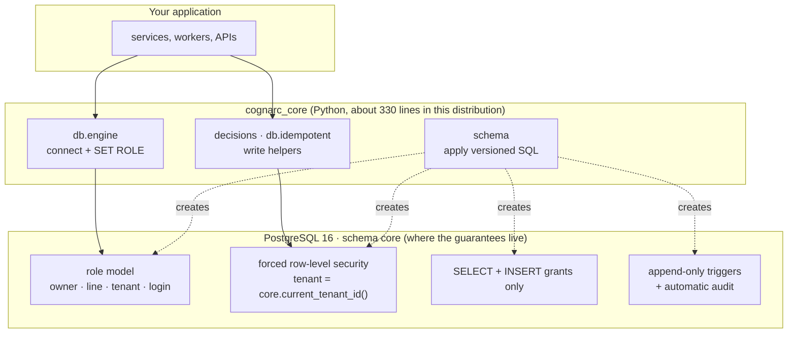
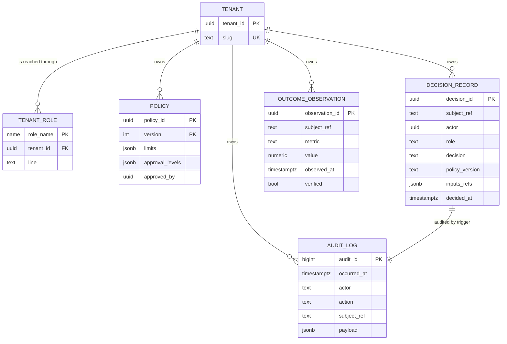
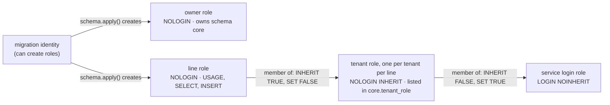
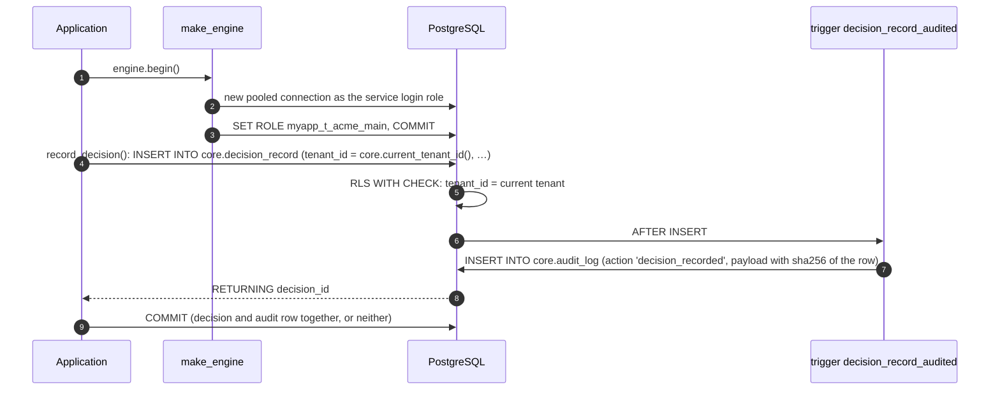
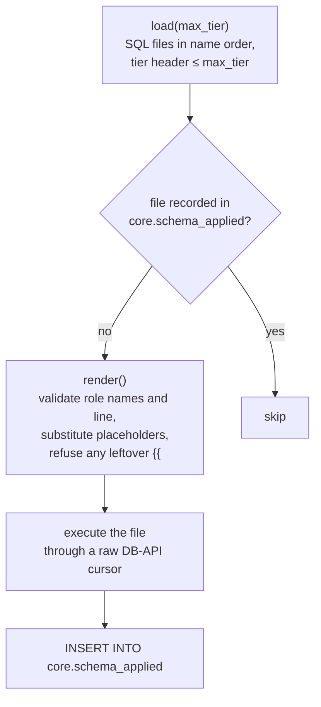

# Architecture

This document explains how Cognarc Core is put together: what each part is responsible for, which
invariants hold and where they are enforced, and where the guarantees stop. It is written for
contributors, reviewers and auditors who want to understand the system before changing or relying
on it.

It complements, and does not repeat, two other documents:

- [`CONTRACT.md`](CONTRACT.md) defines *what* a decision record is: the chain, the objects and their
  required fields.
- [`SCHEMA.md`](SCHEMA.md) explains *how to operate* the schema: applying it and provisioning tenants.

Everything stated here was checked against PostgreSQL 16 with the code in this repository. When the
code and this document disagree, the code is right and this document has a bug.

## Contents

- [Bird's-eye view](#birds-eye-view)
- [Design principles](#design-principles)
- [Code map](#code-map)
- [Data model](#data-model)
- [Roles and tenant isolation](#roles-and-tenant-isolation)
- [The write path](#the-write-path)
- [Idempotent writes](#idempotent-writes)
- [Schema lifecycle](#schema-lifecycle)
- [Trust boundaries](#trust-boundaries)
- [Failure behaviour](#failure-behaviour)
- [Extending Core in your application](#extending-core-in-your-application)
- [Testing](#testing)
- [Distributions](#distributions)
- [Non-goals](#non-goals)

## Bird's-eye view

Cognarc Core has two halves of very different sizes:



The Python package is deliberately thin. It connects as the right role, writes rows in the shape
the contract requires, and applies the schema. **Every guarantee is enforced by PostgreSQL**, so
it holds for any client that reaches the database: another language, a hand-written script, a
psql session, or a bug in your own code.

## Design principles

1. **The database is the enforcement point.** Isolation, immutability and audit are expressed as
   roles, grants, row-level security policies and triggers. Python code may check the same rules
   earlier to produce better errors, but it is never the only line of defence.
2. **One source for the schema.** The SQL files in `src/cognarc_core/schema/sql/` are the schema.
   Python reflects tables at runtime (`cognarc_core.db.reflect`) instead of declaring models, so
   there is nothing to keep in sync.
3. **Append-only records.** Decisions and audit rows are never updated or deleted. A correction is a
   new row that references the one it corrects.
4. **The tenant is derived, never supplied.** A connection's tenant comes from the database role it
   has switched to. No function takes a `tenant_id` argument, and a row claiming another tenant is
   rejected.
5. **Time is unambiguous.** Every timestamp is a timezone-aware UTC `timestamptz`; the database
   default time zone is set to UTC. The four time columns (`event_time`, `published_at`,
   `available_at`, `ingested_at`) are kept separate because they answer different questions.
6. **Idempotency comes from unique keys**, not from application memory or a cache.
7. **No domain and no judgement.** Core does not know what a trade, a release or a loan is, and it
   contains no scoring, recommendation or automatic approval. It records decisions that accountable
   people and systems make.

## Code map

| Path | Responsibility | Entry points |
| --- | --- | --- |
| `src/cognarc_core/__init__.py` | Package root and version | `cognarc_core.tier()`, `cognarc_core.__version__` |
| `src/cognarc_core/_tier.py` | Which distribution is installed; rewritten at export time | `cognarc_core._tier.TIER` |
| `src/cognarc_core/clock.py` | UTC clocks | `cognarc_core.clock.SystemClock`, `ManualClock` (tests) |
| `src/cognarc_core/db/__init__.py` | Database helpers, free of any domain | `cognarc_core.db` |
| `src/cognarc_core/db/engine.py` | Engines that `SET ROLE` on every new connection; role-name allow-list | `cognarc_core.db.engine.make_engine()`, `validate_role_name()` |
| `src/cognarc_core/db/idempotent.py` | Insert-or-return-existing on a unique key | `cognarc_core.db.idempotent.insert_idempotent()` |
| `src/cognarc_core/db/reflect.py` | Table reflection so Python never redefines the schema | `cognarc_core.db.reflect.reflect_table()` |
| `src/cognarc_core/decisions.py` | The minimal implementation of the contract | `cognarc_core.decisions.record_decision()` |
| `src/cognarc_core/schema/__init__.py` | Loading, rendering and applying SQL files | `cognarc_core.schema.apply()`, `load()`, `render()`, `sql_dir()` |
| `src/cognarc_core/schema/sql/` | The schema itself, one numbered file per change | `cognarc_core.schema.sql` package data |
| `src/cognarc_core/schema/sql/000_bootstrap.sql` | Owner and line roles, `core` schema, UTC database default | — |
| `src/cognarc_core/schema/sql/010_tenancy.sql` | Tenants, tenant roles, `core.current_tenant_id()` | — |
| `src/cognarc_core/schema/sql/020_ledger.sql` | `core.policy`, `core.decision_record`, `core.outcome_observation` | — |
| `src/cognarc_core/schema/sql/030_audit_log.sql` | `core.audit_log`, append-only triggers, automatic decision audit | — |
| `contracts/` | JSON Schema of the decision record | `decision_record.schema.json` |
| `examples/quickstart.py` | The README quick start as a runnable script | — |
| `tests/` | Unit tests (no database) and integration tests (marked `db`) | `make test`, `make test-db` |

Start reading at `decisions.py` and `020_ledger.sql`: together they are the whole contract in
executable form.

## Data model



`core.policy`, `core.decision_record` and `core.outcome_observation` also carry the contract's
common spine, omitted from the diagram for readability:

| Column | Meaning |
| --- | --- |
| `tenant_id`, `workspace_id` | Who the row belongs to; `tenant_id` is filled from `core.current_tenant_id()` |
| `event_time`, `published_at`, `available_at`, `ingested_at` | When it happened, was made public, became usable to us, entered the system |
| `valid_from`, `valid_to` | Validity window |
| `source_version` | Version of whatever produced the row |
| `lineage` | Where the row came from (`jsonb`) |
| `confidentiality` | `public`, `internal` or `restricted` (default) |
| `created_at` | Database insert time |

Relationships between ledger objects are references in text form (`subject_ref`, `inputs_refs`
such as `release:2026.10.29` or `pr:412`), not foreign keys. That keeps Core independent of the
tables your application adds, and lets a decision cite evidence that lives elsewhere.

How each table is protected:

| Table | Line role may | Row-level security | Extra protection |
| --- | --- | --- | --- |
| `core.tenant` | nothing | — | Readable and writable only by the owner and the migration identity |
| `core.tenant_role` | `SELECT` | A role sees only its own mapping row | — |
| `core.policy` | `SELECT`, `INSERT` | forced, by tenant | A new version is a new row (`(policy_id, version)` is the key) |
| `core.decision_record` | `SELECT`, `INSERT` | forced, by tenant | Triggers reject `UPDATE`, `DELETE`, `TRUNCATE`; every insert writes an audit row |
| `core.outcome_observation` | `SELECT`, `INSERT` | forced, by tenant | — |
| `core.audit_log` | `SELECT`, `INSERT` | forced, by tenant | Triggers reject `UPDATE`, `DELETE`, `TRUNCATE` |
| `core.schema_applied` | nothing | — | Written only by `schema.apply()` |

`core.policy` and `core.outcome_observation` are protected by privileges alone: no application
role can update them, but they have no mutation trigger. The trigger function used for the
append-only tables, `core.forbid_audit_modification()`, is reusable for your own tables (see
[Extending Core](#extending-core-in-your-application)).

## Roles and tenant isolation

Four kinds of database role are involved. `schema.apply()` creates the first two; your
provisioning creates the others, as described in [`SCHEMA.md`](SCHEMA.md).



Read the membership options carefully; they carry the design:

- The **service login role** is `NOINHERIT` and holds its tenant roles with `INHERIT FALSE`, so on
  its own it has no data privileges at all. It can only `SET ROLE` into a tenant role.
  `make_engine(url, set_role=...)` does that on every new pooled connection and commits immediately,
  because an uncommitted `SET ROLE` would be undone when the pool rolls the connection back.
- A **tenant role** inherits the line role's privileges but cannot `SET ROLE` into the line role
  (`SET FALSE`), so it cannot shed its tenant identity.
- `core.current_tenant_id()` returns the tenant mapped to `current_user` in `core.tenant_role` for
  the line given to `schema.apply()`. A role that is not mapped gets `NULL`.
- Every tenant table has `ENABLE` and `FORCE ROW LEVEL SECURITY` with one policy,
  `tenant_id = core.current_tenant_id()`, for both reading (`USING`) and writing (`WITH CHECK`).
  With `NULL` as the tenant, nothing matches: an unmapped role reads zero rows and cannot insert any.
  `FORCE` applies the policy to the table owner as well.

Role names are interpolated into SQL (`SET ROLE`, `GRANT`), so they are validated against
`[a-z_][a-z0-9_]{0,62}` by `validate_role_name()` before use.

## The write path

What happens when an application records one decision:



Points worth noting:

- `record_decision()` never takes a tenant: `tenant_id` is `core.current_tenant_id()` evaluated in
  the database.
- Time semantics follow the contract: a decision is usable the moment it is made, so
  `event_time = available_at = decided_at = at`, and `ingested_at` is the database's `now()`.
- The audit row is written by a trigger in the same transaction, so a decision without its audit
  row cannot be committed. Its payload contains a SHA-256 of the full decision row as inserted.
- `inputs_refs` is stored as a JSON array of references; it is what lets an action be traced back
  through the decision to its evidence.

## Idempotent writes

`insert_idempotent(conn, table, values, conflict_cols)` writes a row, or returns the existing row if
one with the same unique key is already there. It reports which happened (`created`).

- It runs `INSERT … ON CONFLICT (conflict_cols) DO NOTHING RETURNING *`. If nothing is returned,
  the row already existed and is read back.
- Under `READ COMMITTED`, concurrent writers of the same key wait on the unique index for the first
  one to commit, then take the `DO NOTHING` branch and read the committed row. Every caller ends up
  with the same row.
- A table may have a second unique index that covers the same key, for example a composite one used
  by a foreign key. Concurrent conflicts can then surface on that index, which `ON CONFLICT` does
  not handle. The insert therefore runs inside a savepoint, and a `UniqueViolation` is answered by
  reading the existing row; only if no such row exists is the error raised.
- `index_where` supports partial unique indexes.
- Missing key columns in `values` raise `ValueError` before anything is sent.

## Schema lifecycle



- Each SQL file starts with `-- tier: oss|enterprise|internal`. Files are numbered by tier: `0xx`
  for this distribution, `1xx` for enterprise, `2xx` for internal. `load(max_tier)` returns only the
  files a distribution should apply.
- Each file runs in its own transaction, together with its `core.schema_applied` row. A failing
  file leaves no trace and can be retried.
- Files are executed through the driver's cursor without parameters, because SQL such as
  `format('%I', …)` would otherwise be mistaken for placeholders.
- **Released files are never rewritten.** A change is a new file with the next number. Because
  `core.schema_applied` records file names, not content hashes, a comment-only edit does not affect
  databases that have already applied the file; any edit to DDL would silently diverge from them.
- Upgrading is therefore: install the new version, run `schema.apply()` again with the same
  arguments. Only new files are applied.

## Trust boundaries

The guarantees above are only as strong as the roles that can reach the data. This table states,
for each kind of actor, what the schema does and does not protect against.

| Actor | What it can do | What stops it from doing more |
| --- | --- | --- |
| Service login role before `SET ROLE` | Connect | No privileges: `permission denied for schema core` |
| Tenant role (your application) | Read and insert its own tenant's rows | Row-level security hides and rejects other tenants' rows; grants allow no `UPDATE` or `DELETE`; triggers reject mutation of append-only tables |
| Role bound to no tenant | Nothing useful | `core.current_tenant_id()` is `NULL`: zero rows visible, every insert violates row-level security |
| Owner role | Owns the schema, but `FORCE ROW LEVEL SECURITY` applies to it and it is bound to no tenant, so it sees no rows; `TRUNCATE` is rejected by trigger | **Not protected:** as owner it can `ALTER TABLE … DISABLE TRIGGER` and `NO FORCE ROW LEVEL SECURITY`, after which it can change rows |
| Superuser or `BYPASSRLS` role | Sees every tenant's rows; triggers still reject `UPDATE`, `DELETE`, `TRUNCATE` | **Not protected:** it can disable triggers or policies, or drop them |

The open-source distribution therefore protects records against application bugs, compromised
application credentials and operator mistakes made through the application's roles. It does **not**
protect them against someone who holds the owner role, the migration identity or a superuser. Keep
those credentials out of application configuration, use them only for migrations, and monitor DDL.

Detecting changes made with those privileges requires evidence held outside the database. The
enterprise distribution provides it: a hash chain over the audit log, with daily seals exported to
storage the operator of the database cannot write.

## Failure behaviour

What callers see when a rule is hit, as observed on PostgreSQL 16:

| Situation | Result |
| --- | --- |
| Login role queries without `SET ROLE` | `InsufficientPrivilege`: permission denied for schema core |
| Unmapped role reads a tenant table | Zero rows, no error |
| Unmapped role inserts a decision | `InsufficientPrivilege`: new row violates row-level security policy for table "decision_record" |
| Tenant inserts a row with another `tenant_id` | `InsufficientPrivilege`: new row violates row-level security policy |
| Tenant updates an append-only table | `InsufficientPrivilege`: permission denied for table … |
| Superuser updates or deletes an append-only row, or the owner truncates one | `InsufficientPrivilege` raised by the trigger: `core.audit_log 只允許 INSERT（拒絕 UPDATE）` ("INSERT only, UPDATE rejected") |
| `make_engine` or `schema.render` with an unsafe role name | `RoleNameError` before any SQL is sent |
| A SQL file with a placeholder left after rendering | `SchemaError` before any SQL is sent |
| `insert_idempotent` with a key column missing from `values` | `ValueError` before any SQL is sent |

The trigger messages are currently in Traditional Chinese; match on the SQLSTATE
(`insufficient_privilege`, `42501`) rather than on the text.

## Extending Core in your application

Core ships the objects every domain shares. Your application adds its own, such as an
authorization or an approval table, and should give them the same properties. The pattern below
was run against PostgreSQL 16 with the roles from the quick start.

Create the schema with the migration identity, because the owner role has no `CREATE` privilege on
the database:

```sql
CREATE SCHEMA app AUTHORIZATION myapp_owner;
```

Then, as the owner role:

```sql
SET ROLE myapp_owner;
GRANT USAGE ON SCHEMA app TO myapp_line;

CREATE TABLE app.release_approval (
    approval_id uuid PRIMARY KEY DEFAULT gen_random_uuid(),
    tenant_id uuid NOT NULL REFERENCES core.tenant (tenant_id),
    workspace_id uuid NOT NULL,
    release_ref text NOT NULL,
    approved_by uuid NOT NULL,                     -- a principal id, never a name
    policy_version text,
    event_time timestamptz,
    published_at timestamptz,
    available_at timestamptz,
    ingested_at timestamptz NOT NULL DEFAULT now(),
    lineage jsonb NOT NULL DEFAULT '{}'::jsonb,
    confidentiality text NOT NULL DEFAULT 'restricted'
        CHECK (confidentiality IN ('public', 'internal', 'restricted'))
);
GRANT SELECT, INSERT ON app.release_approval TO myapp_line;

ALTER TABLE app.release_approval ENABLE ROW LEVEL SECURITY;
ALTER TABLE app.release_approval FORCE ROW LEVEL SECURITY;
CREATE POLICY tenant_isolation ON app.release_approval
    USING (tenant_id = core.current_tenant_id()) WITH CHECK (tenant_id = core.current_tenant_id());

CREATE TRIGGER release_approval_no_update_delete BEFORE UPDATE OR DELETE ON app.release_approval
    FOR EACH ROW EXECUTE FUNCTION core.forbid_audit_modification();
CREATE TRIGGER release_approval_no_truncate BEFORE TRUNCATE ON app.release_approval
    FOR EACH STATEMENT EXECUTE FUNCTION core.forbid_audit_modification();
RESET ROLE;
```

Then insert with `tenant_id = core.current_tenant_id()`, record the decision itself with
`record_decision()`, and cite the new row in `inputs_refs` (for example `release_approval:<id>`).
A checklist for any new table:

- [ ] `tenant_id` referencing `core.tenant`, row-level security enabled **and forced**, one policy
      on `core.current_tenant_id()` for both `USING` and `WITH CHECK`.
- [ ] Only `SELECT` and `INSERT` granted to the line role.
- [ ] `core.forbid_audit_modification()` triggers if the table is a record rather than working state.
- [ ] The four time columns where they apply, all `timestamptz`.
- [ ] People stored as principal ids.
- [ ] A `DecisionRecord` for every decision the table supports, including "do nothing".

Keep these tables in your own migrations, not in `core`: the `core` schema belongs to Cognarc Core
and its numbered files.

## Testing

| Suite | Needs | Covers |
| --- | --- | --- |
| `tests/unit/test_schema_loader.py` | nothing | Tier headers and ordering, filtering by tier, rendering and placeholder checks, no reference from open-source SQL to enterprise objects |
| `tests/unit/test_db_helpers.py` | nothing | Role-name allow-list, idempotency argument checks |
| `tests/unit/test_clock.py` | nothing | UTC and the manual clock |
| `tests/unit/test_package_boundary.py` | nothing | Imports resolve within the installed tier; only the standard library and declared dependencies are imported |
| `tests/unit/test_release_metadata.py` | nothing | Package version, `pyproject.toml`, `CITATION.cff` and the changelog agree |
| `tests/unit/test_architecture_doc.py` | nothing | Every module and SQL file is described in this document |
| `tests/integration/test_tenancy_and_ledger.py` | PostgreSQL 16 | Re-running `schema.apply()`, tenant isolation, unmapped roles, automatic audit and immutability, the four time columns, idempotent inserts |

`tests/conftest.py` builds the integration fixture once per session: it recreates a test database,
applies every SQL file, creates two tenants with their own tenant roles and one service login role
that may `SET ROLE` into either. Tests generate their own keys with `uuid4()` and never truncate,
since the audit tables would refuse.

## Distributions

The same package, `cognarc_core`, ships in an open-source and an enterprise distribution, produced
from one source repository. `cognarc_core.tier()` reports which one is installed; install exactly
one per environment. The enterprise distribution adds identity governance and the audit hash
chain, described in its own architecture document, on top of everything here.

## Non-goals

- **No ORM models and no migration framework.** Plain, numbered SQL files are easier to audit than
  generated migrations, and reflection removes the need for models.
- **No tables for evidence, proposals, assessments, authorizations or actions.** Their fields differ
  too much between domains. The contract defines their semantics; your application defines the
  tables, following the pattern above.
- **No service, API or UI.** Core is a library you embed.
- **No scoring, recommendation or automatic approval.**
- **No tamper evidence against database administrators** in this distribution; see
  [Trust boundaries](#trust-boundaries).
